#  sunview-icons
pixmaps which include icons and cursors extracted from the sunview windowing system

## Preview(normal icons):
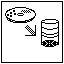
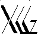

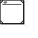

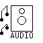

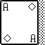
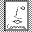
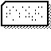

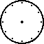

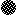

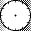
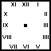
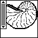
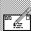

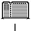

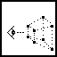
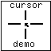
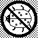

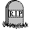

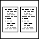
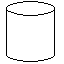

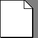

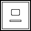
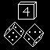
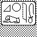

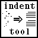

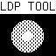

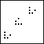

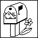
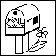
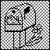

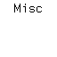
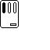

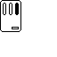
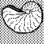

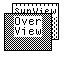

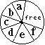

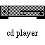

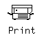

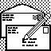
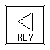
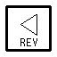
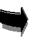
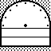

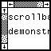
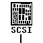
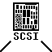
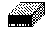

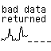

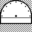
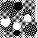

## Preview("pointers"):

## Preview(Cursors):

